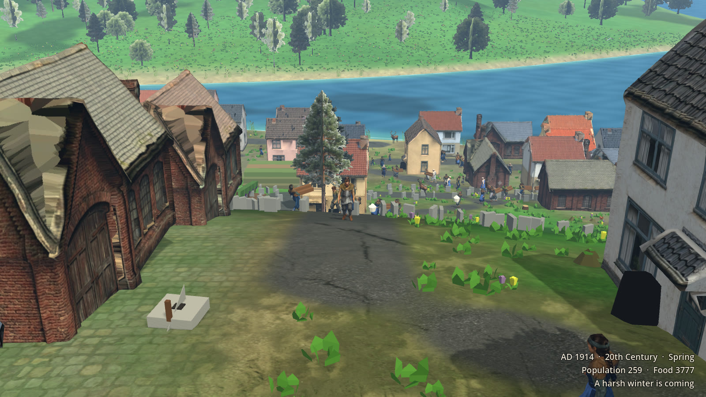
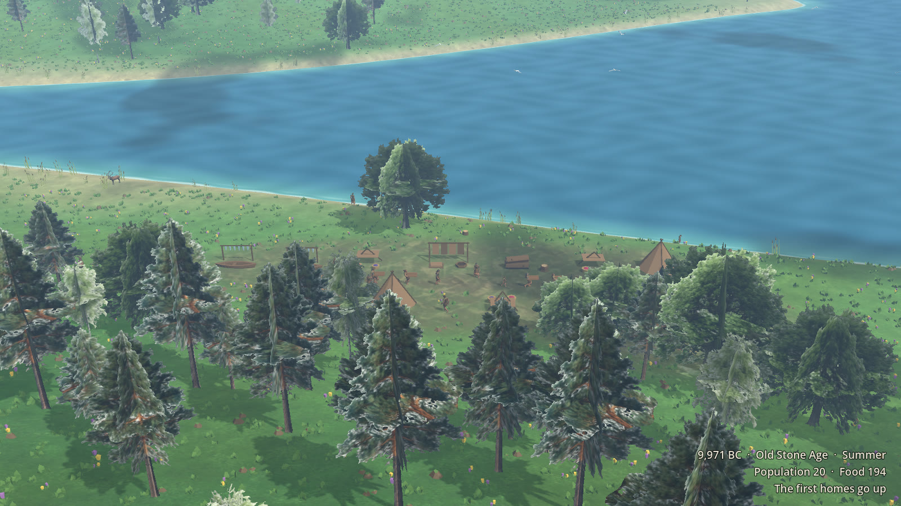

# DeskCiv

DeskCiv is a living desktop wallpaper for Windows. A village on a river estuary grows by itself from the Old Stone Age to the 20th century, behind your desktop icons. You don't control anything; you watch.

Watch the trailer: https://youtu.be/JDI6xkTNL-4

## What happens on screen

- **Eight eras, 12,000 years.** A tribe camps by the river in 10,000 BC. Over the Stone, Bronze and Iron Ages, the Middle Ages, the Renaissance, the Industrial Age and the 20th century, the camp turns into a town of 200-300 people. Each era lasts about 21 real hours.
- **Villagers at work.** People farm, fish, cut wood, quarry stone, grind flour, bake bread, make wine and forge tools. Goods are carried along roads that the village wears into the ground.
- **Land from the sea.** From about 500 AD, villagers build dikes into the estuary, windmills pump the water out, and the new land becomes fields. Storm surges test the dikes.
- **Weather and time of day.** The wallpaper follows your clock: dawn mist, golden evening light, cloud shadows, rain and lit windows at night.
- **History replay.** In the year 2000 the camera circles the town with a summary of each era, and a new world begins.
- **Sound.** Waves, wind, rain, birds and gulls, and a calm music piece for each era. Volume is set from the tray icon, and DeskCiv falls silent when another app plays sound.

## Requirements and performance

Windows 10 or 11 and a GPU with OpenGL 3.3. DeskCiv is built to stay out of your way: at most 30 FPS, under 5% CPU and about 400-500 MB RAM. It pauses rendering when a window covers the desktop.

## Run from source

1. Download Godot 4.7.2 .NET for Windows into `.tools/Godot_v4.7.2-stable_mono_win64/`.
2. Run `start-deskciv.cmd`. Stop it with `stop-deskciv.cmd` or with Quit in the tray icon.

The tray icon also has Pause, Show info, Start with Windows, speed and volume controls.

Test run in a window: `Godot_v4.7.2-stable_mono_win64.exe --path game -- --windowed --resolution 960x540`. Other test flags (`--seed`, `--start-year`, `--hour`, `--weather`, `--shot`, `--look`, `--stream-test`) are listed in `game/src/Main.cs`.

Simulation tests: `dotnet run -c Release` in `tests/SimTests`.

## Streaming to YouTube

`stream-youtube.cmd` streams the game picture and sound (1280x720, 30 fps, GPU-encoded) without showing the desktop. Put your stream key, alone, in `%USERPROFILE%\.deskciv\youtube-stream-key.txt` first, and keep that file private.

## How it is built

- Godot 4.7 with C# and the Compatibility (OpenGL) renderer.
- The simulation (`game/src/Sim`) is deterministic and independent of rendering, so it can be tested headless.
- Buildings, animals and boats come from reference images generated with ChatGPT and Gemini, turned into 3D with an image-to-3D model (`docs/building-pipeline.md`). Villagers use a separate rigging pipeline (`docs/character-pipeline.md`).
- Models in `game/assets/models` reload while the game runs, so new art appears without a restart.

## Assets in this repository

- Buildings, props and scatter: Kenney Fantasy Town Kit and Nature Kit (CC0).
- Animation clips and skeleton: Quaternius Universal Animation Library (CC0).
- Ground textures: Poly Haven (CC0).
- Music: Kevin MacLeod, incompetech.com (CC BY 4.0).
- Nature recordings: Wikimedia Commons contributors (CC BY-SA 4.0 and CC0).
- Concept and reference images: generated with ChatGPT and Gemini (`assets-candidates/concepts`).

Full credits are in `THIRD_PARTY_NOTICES.md`.

## Not included

The realistic buildings, characters, animals and boats are made with Tencent Hunyuan3D. Its licence does not allow distribution in the EU, the UK or South Korea, so those generated models are not published here. Without them, the game uses its low-poly fallback models. You can rebuild them locally from the reference images with the pipelines in `docs/`.

## Licence

The code has no open-source licence yet; all rights are reserved by the author. Third-party assets keep their own licences (see `THIRD_PARTY_NOTICES.md`).
